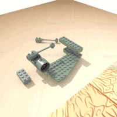
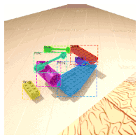
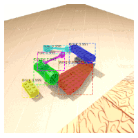
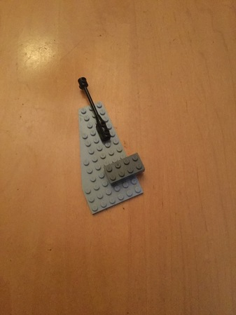
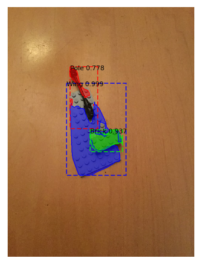
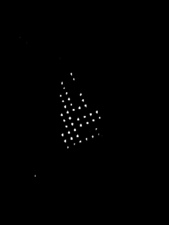
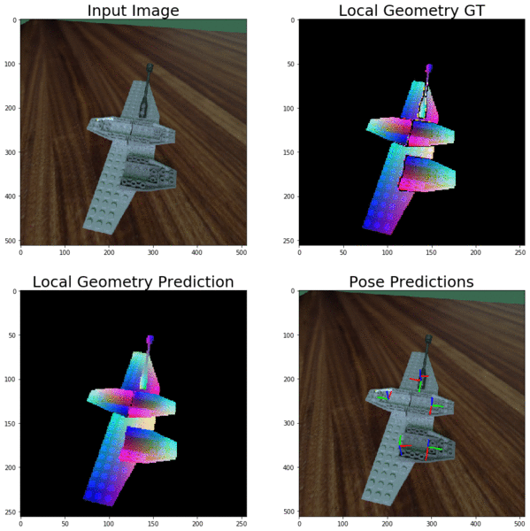

#  Computer vision for Lego comprehension

## Goal 

Create a computer vision system could take as input a single image of some Lego structure and produce as output a 3D model of it.  The output 3D model must consist of the exact arrangement of pieces, not an approximated voxelization of bricks.  

## Architecture

Being new to machine learning, I figured I'd just start by transfer learning with MaskRCNN to identify the pieces in the image and then use traditional CV approaches to estimate poses for each separated piece.  That was simple enough and allowed me to get a better footing in these domains.  I then tried looking into other architectures involving more advanced neural networks to handle more of the process, but had trouble narrowing down the right approach.

## Data

The <a href="https://github.com/WHSnyder/LegoTrainingRenderer">approach for training data</a> was to create a Blender scene with 3D models of the relevant pieces, randomly arrange them into different structures, and render each arrangement to an image, alongside relevant metadata like masks and 3D coordinates. 

## Constraints

Being new to this and lacking a powerful GPU, I decided to restrict the problem space a little bit by using only 4-5, very distinct, Lego pieces in the data.  Covering *all Lego pieces* is not feasible for me.  The training images were also rendered with rather low quality for more throughput.

# Challenges

I was probably in too deep on this whole project and should've added more constraints before getting into this.

* First stage  

	      
	
	* Training data has frequent abnormalities such as pieces lying half off-screen or extreme occlusion.  In such cases a wing could be hidden entirely with the exception of a 2x2 region of studs.  If this wing is viewed from directly above, it will be indistinguishable from a 2x2 brick piece. The network will be forced to make the wrong choice given the infomation at hand.
	* The network is relatively accurate with real images of pieces, though struggles consistently with black pieces and differing resolutions.

	  

* Second stage

	*  For tracking purposes, a tiny Unet produces highlights for studs present in the image.  This is useful since neighboring studs can be plugged into a RANSAC solver for camera localization.

	

	*  A larger Unet generates local geometry mappings for the pieces present in the image.  These local coordinates are plugged into OpenCV's RANSAC solver.  This method works reliably for most pieces with distinct features, but fails more often with flat, uniformly studded pieces like wings.  Fine tuning this network while trying to expand piece coverage is tricky.  It's very likely that it'll be used to refine pointclouds from world space to Lego voxels instead of directly estimating pose in future iterations.  Not to mention, it cannot handle heavily occluded bricks, something I was hoping it would magically accomplish.

	

* Third stage 

	* Studs and insets are brute-force matched with one another to find likely fits between nearby pieces. A lazy solution that works well enough for now.

# Future directions

* Full pose estimation networks such as <a href="https://github.com/dineshreddy91/Occlusion_Net">OcclusionNet</a> or <a href="https://github.com/yuxng/PoseCNN">PoseCNN</a>  

* Multi-view approaches

* A reinforcement learning guess-rerender-refine approach to pose estimation or an iterative model as in this <a href="https://arxiv.org/pdf/1507.06550.pdf">human pose estimation method.</a> 

* Training a network to estimate a voxelization and applying a sort-of '3D Mask-RCNN' model on that voxelization.
